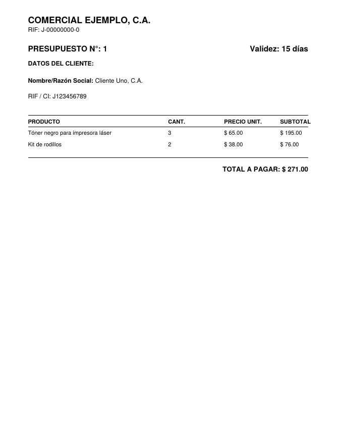
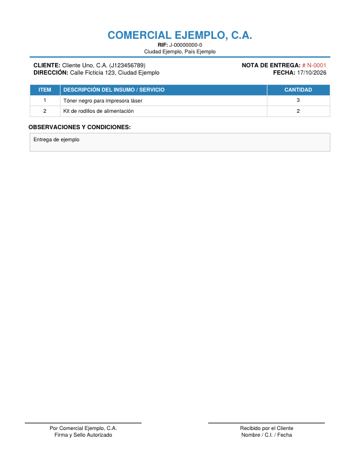
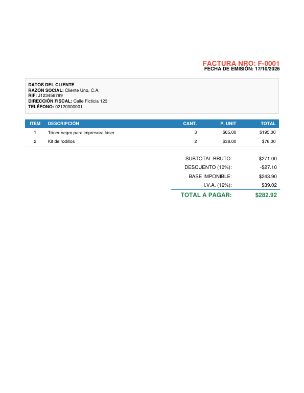

# Sistema Administrativo para PyME

Aplicación de escritorio en Python para **administrar un pequeño negocio de venta de insumos**: inventario, clientes, proveedores, presupuestos, facturación, notas de entrega y cuentas por pagar, con reportes en PDF.

Desarrollada por **Arnulfo José Azuaje Roa** a partir de un sistema real usado en una importadora. En este repositorio **todos los datos son ficticios**: la empresa, los RIF, las direcciones, los teléfonos y los precios son inventados.

## Qué resuelve

- Llevar el **inventario** con movimientos de ingreso y egreso, y ver qué está por debajo del mínimo.
- Emitir **presupuestos**, **facturas de forma libre** (con descuento e IVA) y **notas de entrega** en PDF.
- Controlar **cuentas por pagar**: facturas de compra a proveedores, abonos y saldos. Al registrar una compra, el stock se actualiza en la misma transacción.
- Mantener ficheros de **clientes** y **proveedores** con validación de RIF y teléfono.
- Sacar **reportes** de inventario general, inventario crítico, deudas pendientes e historial de pagos.
- Cargar productos de forma **masiva desde Excel o CSV**.

## Capturas de los documentos generados

| Presupuesto | Nota de entrega | Factura |
|---|---|---|
|  |  |  |

## Tecnologías

Python 3 · CustomTkinter (interfaz) · SQLite · pandas / openpyxl (carga masiva) · ReportLab (PDF) · pytest

## Puesta en marcha

```bash
python -m venv .venv
# Windows:  .venv\Scripts\activate
# Linux/Mac: source .venv/bin/activate
pip install -r requirements.txt

python seed_demo.py --reset   # crea la base con datos FICTICIOS de ejemplo
python main.py                # abre la aplicación
```

### Configuración

Los datos que aparecen en los documentos y las rutas se definen con variables de entorno (o editando `config.py`):

| Variable | Para qué sirve | Por defecto |
|---|---|---|
| `EMPRESA_NOMBRE` | Nombre en los encabezados de los PDF | `Comercial Ejemplo, C.A.` |
| `EMPRESA_RIF` | RIF de la empresa | `J-00000000-0` |
| `EMPRESA_CIUDAD` | Ciudad / país | `Ciudad Ejemplo, País Ejemplo` |
| `SISTEMA_DB` | Ruta de la base SQLite | `data/sistema_administrativo.db` |
| `SISTEMA_SALIDA` | Carpeta donde se guardan los PDF | `salida/` |
| `SISTEMA_NO_ABRIR` | Si se define, no abre los PDF al generarlos | no definida |

Ejemplo en PowerShell:

```powershell
$env:EMPRESA_NOMBRE="Mi Empresa, C.A."
$env:EMPRESA_RIF="J-12345678-9"
python main.py
```

## Pruebas

```bash
pytest
```

21 pruebas: la capa de datos (altas y bajas de productos, ventas con control de stock, validación de RIF y teléfono, facturas de compra con actualización de inventario, abonos y saldos, reversión de transacciones con error) y la generación de PDF (contenido, caracteres especiales y documentos de varias páginas).

## Estructura

```
main.py              Menú principal
config.py            Datos de la empresa, rutas y utilidades
base_datos.py        Esquema SQLite y todas las operaciones de datos
documentos.py        Nota de entrega y factura en PDF (ReportLab)
app_*.py             Una ventana por módulo (inventario, clientes, presupuestos, ...)
seed_demo.py         Datos ficticios de ejemplo
tests/               Pruebas con pytest
```

## Limitaciones

- Los RIF se validan con formato venezolano (una letra y 9 dígitos) y los teléfonos con 11 dígitos; para otro país habría que adaptar `validar_formato_rif` y `validar_formato_telefono`.
- El IVA está fijo en 16 % en la facturación.
- La interfaz gráfica no tiene pruebas automáticas; las pruebas cubren la capa de datos.
- Es una aplicación de un solo usuario sobre SQLite, sin autenticación.

## Licencia

Sin licencia definida: todos los derechos reservados por el autor.
